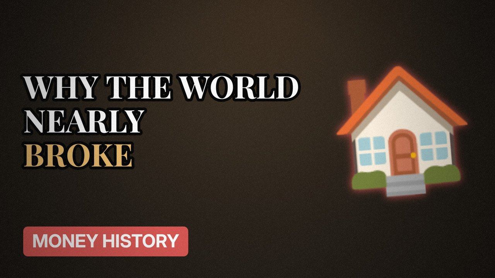

# MV061 · The 2008 Crash Explained Simply



## Paste this to Claude

```
Make video MV061 from my idea bank: write and fact-check the full 5+ minute script, render it in its style, and send it to me.
```

**Category:** Money history  
**Editing style:** Archive documentary. Film grain, letterbox bars, serif type, newspaper cuttings and maps. The camera pans sideways from one moment to the next instead of cutting.  
**Length:** 6 to 8 minutes (about 1,000 to 1,300 words)

## Hook (first line)

> In 2008 the world nearly ran out of money because of mortgages in America that should never have been sold.

## Outline

1. Easy mortgages
2. Bundling loans together
3. Ratings that were wrong
4. When house prices fell
5. Banks frozen
6. What it cost ordinary people

## YouTube title

The 2008 Crash Explained Simply

## YouTube description

```
In 2008 the world nearly ran out of money because of mortgages in America that should never have been sold.

In this video:
- Easy mortgages
- Bundling loans together
- Ratings that were wrong
- When house prices fell
- Banks frozen
- What it cost ordinary people

Sources are listed here once the script has been fact-checked.
This video is for education and entertainment only and is not financial advice.

#money #historyofmoney #economichistory
```

## Tags

history of money, economic history, financial history, the 2008 crash explained simply, 2008, crash, explained, simply, money explained

## Facts to check before scripting

- Key facts on subprime lending
- UK bank bailout figures

## Script approach

Script formula: the hook is the first sentence (no intro), then 4 to 6 chapters, each opening with a question the viewer wants answered. Keep sentences short and spoken. Close every chapter with a mini-cliffhanger into the next, and end on a one-line takeaway.
