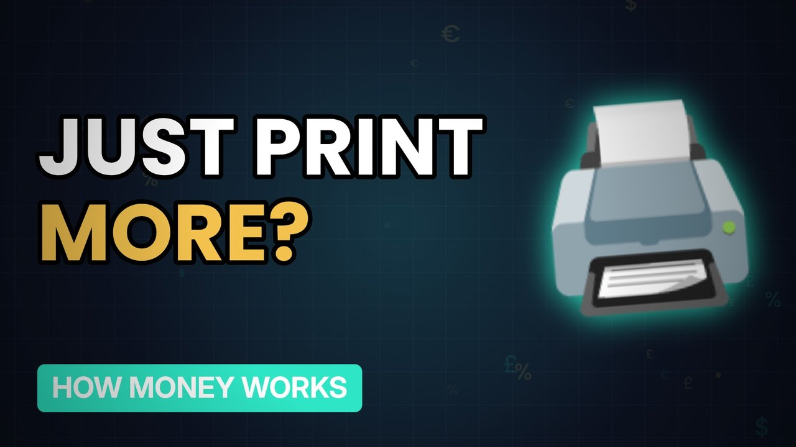

# MV064 · Why Can't We Just Print More Money?



## Paste this to Claude

```
Make video MV064 from my idea bank: write and fact-check the full 5+ minute script, render it in its style, and send it to me.
```

**Category:** How money works  
**Editing style:** Ledger. Dark motion graphics: glowing numbers, charts and icons, soft crossfades. Clean and data-led.  
**Length:** 6 to 8 minutes (about 1,000 to 1,300 words)

## Hook (first line)

> If the government can print money, why doesn't it just print enough to make everyone rich?

## Outline

1. Money is a claim on stuff
2. More money, same stuff
3. Examples from history
4. Quantitative easing explained
5. When printing works
6. Why it's a balancing act

## YouTube title

Why Can't We Just Print More Money?

## YouTube description

```
If the government can print money, why doesn't it just print enough to make everyone rich?

In this video:
- Money is a claim on stuff
- More money, same stuff
- Examples from history
- Quantitative easing explained
- When printing works
- Why it's a balancing act

Sources are listed here once the script has been fact-checked.
This video is for education and entertainment only and is not financial advice.

#money #moneyexplained #economics
```

## Tags

money explained, economics, personal finance uk, why can't we just print more money?, can't, just, print, more

## Facts to check before scripting

- QE amounts in the UK
- Historical examples to cite

## Script approach

Script formula: the hook is the first sentence (no intro), then 4 to 6 chapters, each opening with a question the viewer wants answered. Keep sentences short and spoken. Close every chapter with a mini-cliffhanger into the next, and end on a one-line takeaway.
