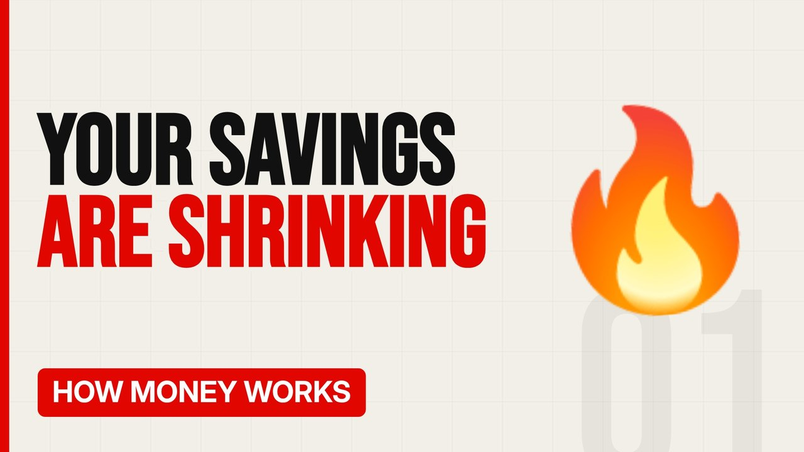

# MV065 · How Inflation Quietly Steals Your Savings



## Paste this to Claude

```
Make video MV065 from my idea bank: write and fact-check the full 5+ minute script, render it in its style, and send it to me.
```

**Category:** How money works  
**Editing style:** Bold minimal. Off-white page, giant condensed capitals, black and red only. Hard, punchy cuts on the beat.  
**Length:** 6 to 8 minutes (about 1,000 to 1,300 words)

## Hook (first line)

> If your savings earn less than inflation, you're getting poorer without spending a penny.

## Outline

1. What inflation is
2. How it's measured
3. Real vs nominal
4. Who wins and who loses
5. Protecting your money
6. The Bank of England's target

## YouTube title

How Inflation Quietly Steals Your Savings

## YouTube description

```
If your savings earn less than inflation, you're getting poorer without spending a penny.

In this video:
- What inflation is
- How it's measured
- Real vs nominal
- Who wins and who loses
- Protecting your money
- The Bank of England's target

Sources are listed here once the script has been fact-checked.
This video is for education and entertainment only and is not financial advice.

#money #moneyexplained #economics
```

## Tags

money explained, economics, personal finance uk, how inflation quietly steals your savings, inflation, quietly, steals, your

## Facts to check before scripting

- Current UK inflation rate
- Bank of England target (2%)

## Script approach

Script formula: the hook is the first sentence (no intro), then 4 to 6 chapters, each opening with a question the viewer wants answered. Keep sentences short and spoken. Close every chapter with a mini-cliffhanger into the next, and end on a one-line takeaway.
