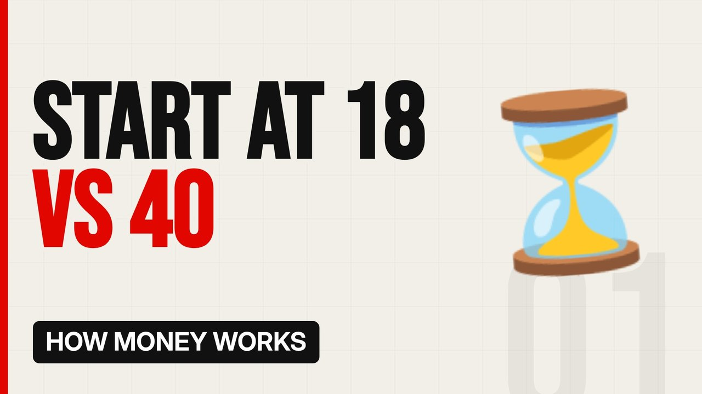

# MV068 · How Compound Interest Turns Small Money Into a Fortune



## Paste this to Claude

```
Make video MV068 from my idea bank: write and fact-check the full 5+ minute script, render it in its style, and send it to me.
```

**Category:** How money works  
**Editing style:** Bold minimal. Off-white page, giant condensed capitals, black and red only. Hard, punchy cuts on the beat.  
**Length:** 6 to 8 minutes (about 1,000 to 1,300 words)

## Hook (first line)

> A little money saved at 18 can be worth more than a lot saved at 40.

## Outline

1. Interest on interest
2. The rule of 72
3. Starting early vs late
4. The other side: debt
5. Fees that eat returns
6. A simple example

## YouTube title

How Compound Interest Turns Small Money Into a Fortune

## YouTube description

```
A little money saved at 18 can be worth more than a lot saved at 40.

In this video:
- Interest on interest
- The rule of 72
- Starting early vs late
- The other side: debt
- Fees that eat returns
- A simple example

Sources are listed here once the script has been fact-checked.
This video is for education and entertainment only and is not financial advice.

#money #moneyexplained #economics
```

## Tags

money explained, economics, personal finance uk, how compound interest turns small money into a fortune, compound, interest, turns, small

## Facts to check before scripting

- Worked examples calculated precisely
- Not financial advice note

## Script approach

Script formula: the hook is the first sentence (no intro), then 4 to 6 chapters, each opening with a question the viewer wants answered. Keep sentences short and spoken. Close every chapter with a mini-cliffhanger into the next, and end on a one-line takeaway.
