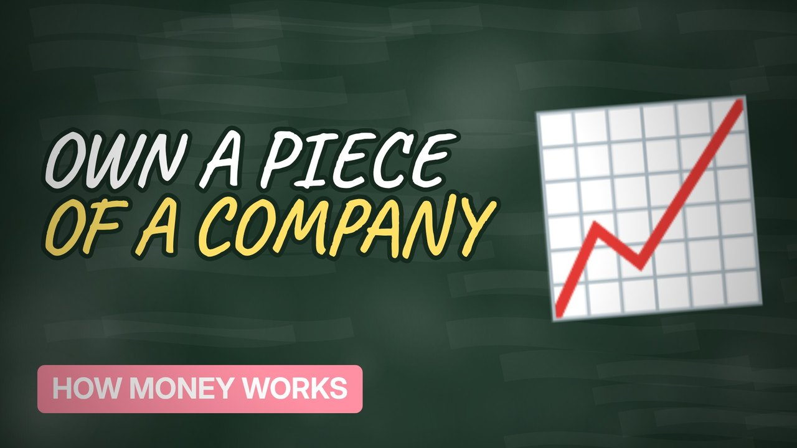

# MV069 · How the Stock Market Actually Works



## Paste this to Claude

```
Make video MV069 from my idea bank: write and fact-check the full 5+ minute script, render it in its style, and send it to me.
```

**Category:** How money works  
**Editing style:** Blackboard. A chalkboard in a wooden frame with handwritten text. Scenes change with an eraser wipe, like a teacher explaining on the board.  
**Length:** 6 to 8 minutes (about 1,000 to 1,300 words)

## Hook (first line)

> Buying a share means owning a tiny piece of a real company, but prices move for all sorts of reasons.

## Outline

1. What a share is
2. Why companies sell them
3. Why prices move
4. Indexes like the FTSE 100
5. Dividends
6. Risk explained simply

## YouTube title

How the Stock Market Actually Works

## YouTube description

```
Buying a share means owning a tiny piece of a real company, but prices move for all sorts of reasons.

In this video:
- What a share is
- Why companies sell them
- Why prices move
- Indexes like the FTSE 100
- Dividends
- Risk explained simply

Sources are listed here once the script has been fact-checked.
This video is for education and entertainment only and is not financial advice.

#money #moneyexplained #economics
```

## Tags

money explained, economics, personal finance uk, how the stock market actually works, stock, market, actually, works

## Facts to check before scripting

- FTSE 100 basics

## Script approach

Script formula: the hook is the first sentence (no intro), then 4 to 6 chapters, each opening with a question the viewer wants answered. Keep sentences short and spoken. Close every chapter with a mini-cliffhanger into the next, and end on a one-line takeaway.
