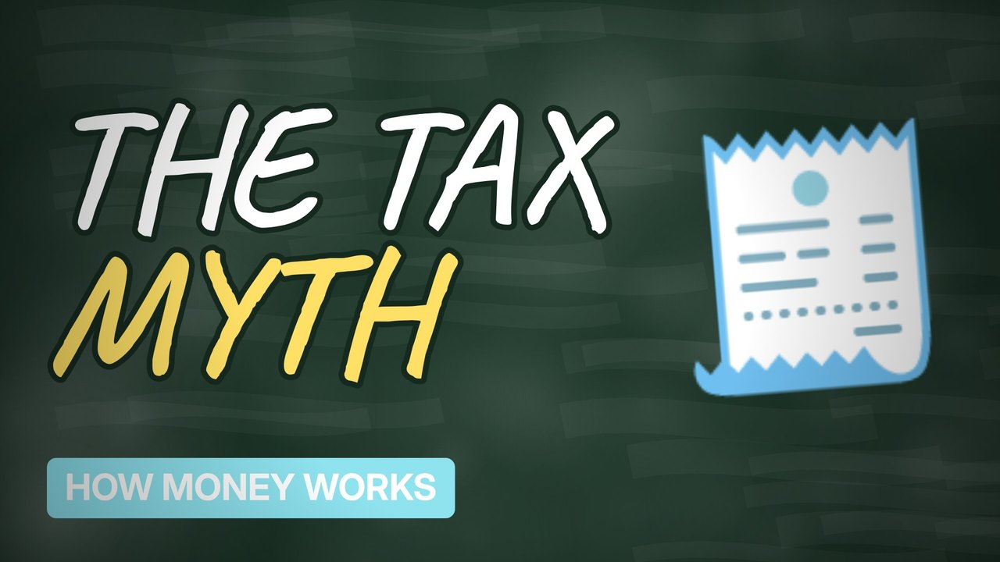

# MV072 · How UK Tax Actually Works



## Paste this to Claude

```
Make video MV072 from my idea bank: write and fact-check the full 5+ minute script, render it in its style, and send it to me.
```

**Category:** How money works  
**Editing style:** Blackboard. A chalkboard in a wooden frame with handwritten text. Scenes change with an eraser wipe, like a teacher explaining on the board.  
**Length:** 6 to 8 minutes (about 1,000 to 1,300 words)

## Hook (first line)

> Most people think a pay rise can leave you worse off because of tax. That's almost never true.

## Outline

1. Personal allowance
2. Tax bands
3. National Insurance
4. Why a pay rise is still a rise
5. The odd traps (the £100k problem)
6. Where the money goes

## YouTube title

How UK Tax Actually Works

## YouTube description

```
Most people think a pay rise can leave you worse off because of tax. That's almost never true.

In this video:
- Personal allowance
- Tax bands
- National Insurance
- Why a pay rise is still a rise
- The odd traps (the £100k problem)
- Where the money goes

Sources are listed here once the script has been fact-checked.
This video is for education and entertainment only and is not financial advice.

#money #moneyexplained #economics
```

## Tags

money explained, economics, personal finance uk, how uk tax actually works, actually, works

## Facts to check before scripting

- Current tax bands and allowance
- Personal allowance taper over £100k

## Script approach

Script formula: the hook is the first sentence (no intro), then 4 to 6 chapters, each opening with a question the viewer wants answered. Keep sentences short and spoken. Close every chapter with a mini-cliffhanger into the next, and end on a one-line takeaway.
