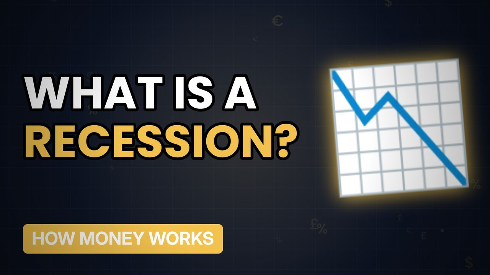

# MV073 · What Is a Recession, Really?



## Paste this to Claude

```
Make video MV073 from my idea bank: write and fact-check the full 5+ minute script, render it in its style, and send it to me.
```

**Category:** How money works  
**Editing style:** Ledger. Dark motion graphics: glowing numbers, charts and icons, soft crossfades. Clean and data-led.  
**Length:** 6 to 8 minutes (about 1,000 to 1,300 words)

## Hook (first line)

> A recession isn't the end of the world, but it can feel like one for the people who lose their jobs.

## Outline

1. The usual definition
2. Why GDP shrinks
3. Who gets hit
4. Past UK recessions
5. How they end
6. What to do if one comes

## YouTube title

What Is a Recession, Really?

## YouTube description

```
A recession isn't the end of the world, but it can feel like one for the people who lose their jobs.

In this video:
- The usual definition
- Why GDP shrinks
- Who gets hit
- Past UK recessions
- How they end
- What to do if one comes

Sources are listed here once the script has been fact-checked.
This video is for education and entertainment only and is not financial advice.

#money #moneyexplained #economics
```

## Tags

money explained, economics, personal finance uk, what is a recession, really?, what, recession, really

## Facts to check before scripting

- UK definition (two quarters of falling GDP)
- Past recession dates

## Script approach

Script formula: the hook is the first sentence (no intro), then 4 to 6 chapters, each opening with a question the viewer wants answered. Keep sentences short and spoken. Close every chapter with a mini-cliffhanger into the next, and end on a one-line takeaway.
