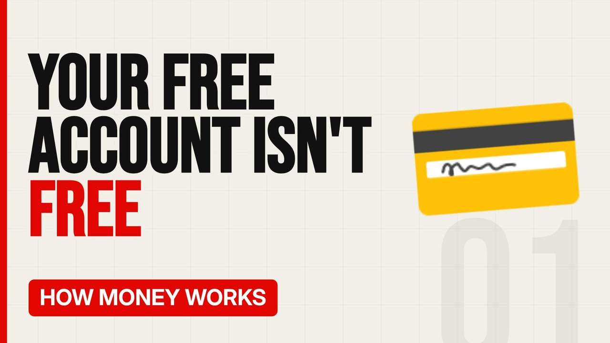

# MV074 · How Banks Make Money From Your Current Account



## Paste this to Claude

```
Make video MV074 from my idea bank: write and fact-check the full 5+ minute script, render it in its style, and send it to me.
```

**Category:** How money works  
**Editing style:** Bold minimal. Off-white page, giant condensed capitals, black and red only. Hard, punchy cuts on the beat.  
**Length:** 6 to 8 minutes (about 1,000 to 1,300 words)

## Hook (first line)

> Your free bank account isn't free. You're just not the one paying for it directly.

## Outline

1. Lending your deposits
2. Interest margins
3. Overdraft fees
4. Card fees paid by shops
5. Selling you other products
6. How to make it work for you

## YouTube title

How Banks Make Money From Your Current Account

## YouTube description

```
Your free bank account isn't free. You're just not the one paying for it directly.

In this video:
- Lending your deposits
- Interest margins
- Overdraft fees
- Card fees paid by shops
- Selling you other products
- How to make it work for you

Sources are listed here once the script has been fact-checked.
This video is for education and entertainment only and is not financial advice.

#money #moneyexplained #economics
```

## Tags

money explained, economics, personal finance uk, how banks make money from your current account, banks, make, money, from

## Facts to check before scripting

- Interchange fee caps in the UK
- Typical overdraft rates

## Script approach

Script formula: the hook is the first sentence (no intro), then 4 to 6 chapters, each opening with a question the viewer wants answered. Keep sentences short and spoken. Close every chapter with a mini-cliffhanger into the next, and end on a one-line takeaway.
