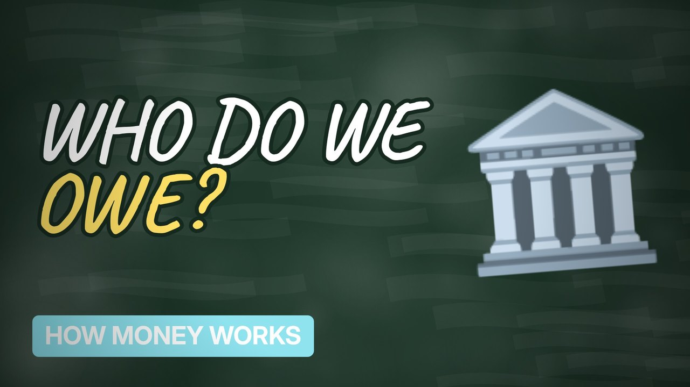

# MV075 · Who Owns the National Debt?



## Paste this to Claude

```
Make video MV075 from my idea bank: write and fact-check the full 5+ minute script, render it in its style, and send it to me.
```

**Category:** How money works  
**Editing style:** Blackboard. A chalkboard in a wooden frame with handwritten text. Scenes change with an eraser wipe, like a teacher explaining on the board.  
**Length:** 6 to 8 minutes (about 1,000 to 1,300 words)

## Hook (first line)

> The UK owes trillions of pounds, but a big chunk of it is owed to... ourselves.

## Outline

1. What government debt is
2. Gilts explained
3. Who owns them
4. Pension funds and the Bank of England
5. Interest costs
6. Is it a problem?

## YouTube title

Who Owns the National Debt?

## YouTube description

```
The UK owes trillions of pounds, but a big chunk of it is owed to... ourselves.

In this video:
- What government debt is
- Gilts explained
- Who owns them
- Pension funds and the Bank of England
- Interest costs
- Is it a problem?

Sources are listed here once the script has been fact-checked.
This video is for education and entertainment only and is not financial advice.

#money #moneyexplained #economics
```

## Tags

money explained, economics, personal finance uk, who owns the national debt?, owns, national, debt

## Facts to check before scripting

- Current debt figure
- Breakdown of gilt ownership

## Script approach

Script formula: the hook is the first sentence (no intro), then 4 to 6 chapters, each opening with a question the viewer wants answered. Keep sentences short and spoken. Close every chapter with a mini-cliffhanger into the next, and end on a one-line takeaway.
