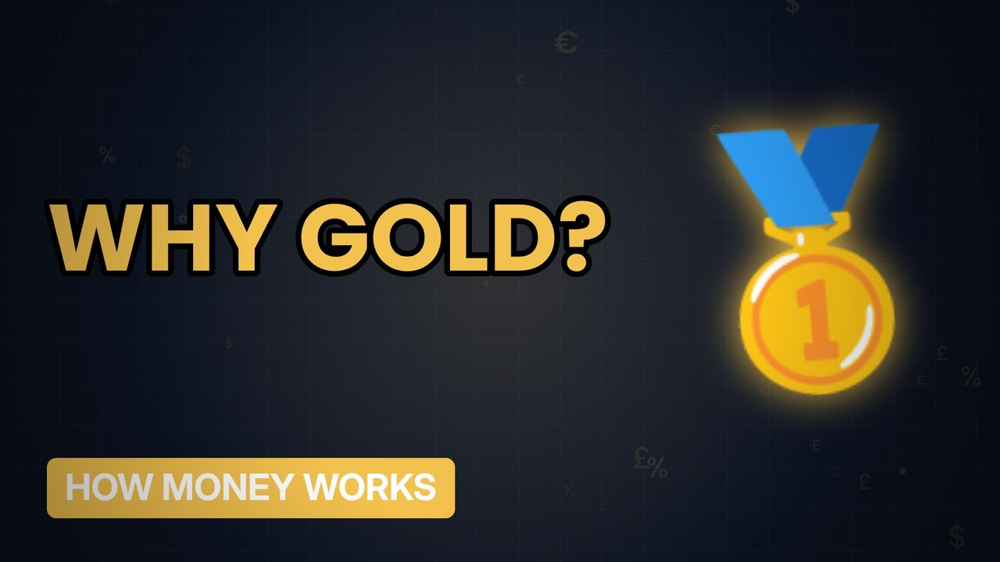

# MV076 · Why Is Gold So Valuable?



## Paste this to Claude

```
Make video MV076 from my idea bank: write and fact-check the full 5+ minute script, render it in its style, and send it to me.
```

**Category:** How money works  
**Editing style:** Ledger. Dark motion graphics: glowing numbers, charts and icons, soft crossfades. Clean and data-led.  
**Length:** 6 to 8 minutes (about 1,000 to 1,300 words)

## Hook (first line)

> Gold is mostly useless for everyday life, yet people have treasured it for thousands of years.

## Outline

1. Rare but not too rare
2. It never rusts
3. Money for millennia
4. Central banks still buy it
5. Gold in crises
6. Is it a good investment?

## YouTube title

Why Is Gold So Valuable?

## YouTube description

```
Gold is mostly useless for everyday life, yet people have treasured it for thousands of years.

In this video:
- Rare but not too rare
- It never rusts
- Money for millennia
- Central banks still buy it
- Gold in crises
- Is it a good investment?

Sources are listed here once the script has been fact-checked.
This video is for education and entertainment only and is not financial advice.

#money #moneyexplained #economics
```

## Tags

money explained, economics, personal finance uk, why is gold so valuable?, gold, valuable

## Facts to check before scripting

- Total gold ever mined (estimate)
- Recent central bank buying

## Script approach

Script formula: the hook is the first sentence (no intro), then 4 to 6 chapters, each opening with a question the viewer wants answered. Keep sentences short and spoken. Close every chapter with a mini-cliffhanger into the next, and end on a one-line takeaway.
