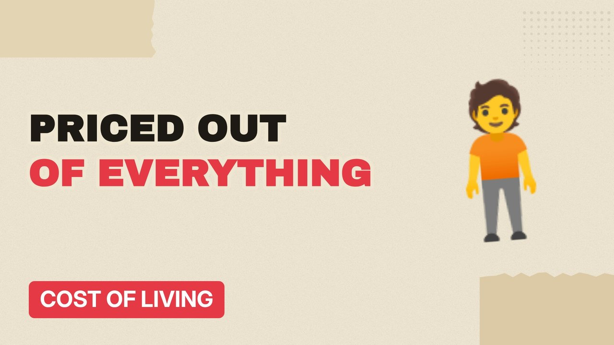

# MV077 · Every Basic Thing Gen Z Got Priced Out Of



## Paste this to Claude

```
Make video MV077 from my idea bank: write and fact-check the full 5+ minute script, render it in its style, and send it to me.
```

**Category:** Cost of living  
**Editing style:** Paper collage. Cream paper, torn cut-outs, red marker colours and heavy type. Each new scene slaps down like a card on a table.  
**Length:** 6 to 8 minutes (about 1,000 to 1,300 words)

## Hook (first line)

> Things your parents took for granted at 25 are now out of reach for millions of young Brits.

## Outline

1. Buying a house
2. Renting alone
3. Learning to drive
4. Going to university
5. Nights out
6. What's actually cheaper now

## YouTube title

Every Basic Thing Gen Z Got Priced Out Of

## YouTube description

```
Things your parents took for granted at 25 are now out of reach for millions of young Brits.

In this video:
- Buying a house
- Renting alone
- Learning to drive
- Going to university
- Nights out
- What's actually cheaper now

Sources are listed here once the script has been fact-checked.
This video is for education and entertainment only and is not financial advice.

#money #costofliving #ukmoney
```

## Tags

cost of living, uk money, personal finance uk, every basic thing gen z got priced out of, every, basic, thing, priced, money explained

## Facts to check before scripting

- Average age of first-time buyers then and now
- Driving lesson and insurance costs

## Script approach

Script formula: the hook is the first sentence (no intro), then 4 to 6 chapters, each opening with a question the viewer wants answered. Keep sentences short and spoken. Close every chapter with a mini-cliffhanger into the next, and end on a one-line takeaway.
