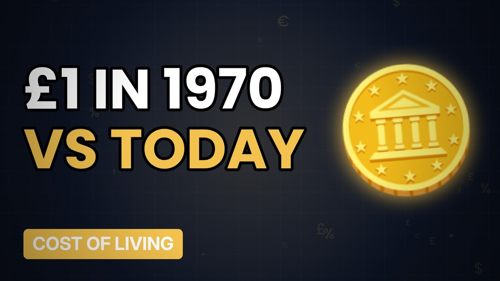

# MV078 · What £1 Bought You in 1970 vs Today



## Paste this to Claude

```
Make video MV078 from my idea bank: write and fact-check the full 5+ minute script, render it in its style, and send it to me.
```

**Category:** Cost of living  
**Editing style:** Ledger. Dark motion graphics: glowing numbers, charts and icons, soft crossfades. Clean and data-led.  
**Length:** 6 to 8 minutes (about 1,000 to 1,300 words)

## Hook (first line)

> In 1970 a pound could buy you a decent lunch out. Today it might buy a chocolate bar.

## Outline

1. The 1970 shopping basket
2. Bread, milk and beer
3. Cinema and bus fares
4. Houses then and now
5. Wages then and now
6. Are we really worse off?

## YouTube title

What £1 Bought You in 1970 vs Today

## YouTube description

```
In 1970 a pound could buy you a decent lunch out. Today it might buy a chocolate bar.

In this video:
- The 1970 shopping basket
- Bread, milk and beer
- Cinema and bus fares
- Houses then and now
- Wages then and now
- Are we really worse off?

Sources are listed here once the script has been fact-checked.
This video is for education and entertainment only and is not financial advice.

#money #costofliving #ukmoney
```

## Tags

cost of living, uk money, personal finance uk, what £1 bought you in 1970 vs today, what, bought, 1970, today, money explained

## Facts to check before scripting

- ONS/historic prices for each item
- Inflation-adjusted values

## Script approach

Script formula: the hook is the first sentence (no intro), then 4 to 6 chapters, each opening with a question the viewer wants answered. Keep sentences short and spoken. Close every chapter with a mini-cliffhanger into the next, and end on a one-line takeaway.
