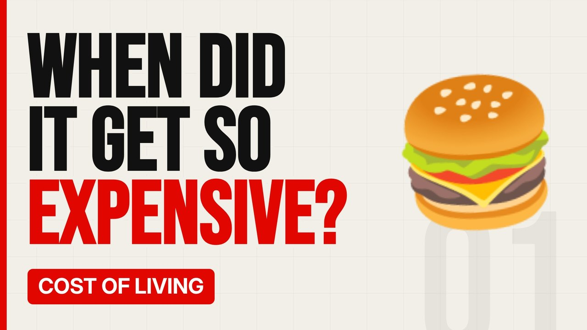

# MV079 · Why Fast Food Got So Expensive



## Paste this to Claude

```
Make video MV079 from my idea bank: write and fact-check the full 5+ minute script, render it in its style, and send it to me.
```

**Category:** Cost of living  
**Editing style:** Bold minimal. Off-white page, giant condensed capitals, black and red only. Hard, punchy cuts on the beat.  
**Length:** 6 to 8 minutes (about 1,000 to 1,300 words)

## Hook (first line)

> Fast food used to be the cheap option. Now a meal can cost the same as a sit-down restaurant.

## Outline

1. Price rises vs inflation
2. Wages, rent and energy
3. App-only deals
4. Delivery fees
5. Smaller portions
6. How to eat out cheaper

## YouTube title

Why Fast Food Got So Expensive

## YouTube description

```
Fast food used to be the cheap option. Now a meal can cost the same as a sit-down restaurant.

In this video:
- Price rises vs inflation
- Wages, rent and energy
- App-only deals
- Delivery fees
- Smaller portions
- How to eat out cheaper

Sources are listed here once the script has been fact-checked.
This video is for education and entertainment only and is not financial advice.

#money #costofliving #ukmoney
```

## Tags

cost of living, uk money, personal finance uk, why fast food got so expensive, fast, food, expensive, money explained

## Facts to check before scripting

- Price examples over time from reliable sources

## Script approach

Script formula: the hook is the first sentence (no intro), then 4 to 6 chapters, each opening with a question the viewer wants answered. Keep sentences short and spoken. Close every chapter with a mini-cliffhanger into the next, and end on a one-line takeaway.
