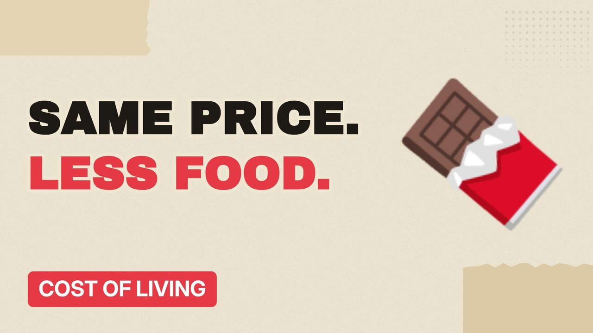

# MV080 · Shrinkflation: Why Your Snacks Got Smaller



## Paste this to Claude

```
Make video MV080 from my idea bank: write and fact-check the full 5+ minute script, render it in its style, and send it to me.
```

**Category:** Cost of living  
**Editing style:** Paper collage. Cream paper, torn cut-outs, red marker colours and heavy type. Each new scene slaps down like a card on a table.  
**Length:** 6 to 8 minutes (about 1,000 to 1,300 words)

## Hook (first line)

> Your favourite chocolate bar may cost the same, but there's a good chance there's less of it.

## Outline

1. What shrinkflation is
2. Famous examples
3. Why brands do it
4. Unit pricing
5. The rules in the UK
6. How to spot it

## YouTube title

Shrinkflation: Why Your Snacks Got Smaller

## YouTube description

```
Your favourite chocolate bar may cost the same, but there's a good chance there's less of it.

In this video:
- What shrinkflation is
- Famous examples
- Why brands do it
- Unit pricing
- The rules in the UK
- How to spot it

Sources are listed here once the script has been fact-checked.
This video is for education and entertainment only and is not financial advice.

#money #costofliving #ukmoney
```

## Tags

cost of living, uk money, personal finance uk, shrinkflation, your, snacks, smaller, money explained

## Facts to check before scripting

- Named product size changes with dates and sources

## Script approach

Script formula: the hook is the first sentence (no intro), then 4 to 6 chapters, each opening with a question the viewer wants answered. Keep sentences short and spoken. Close every chapter with a mini-cliffhanger into the next, and end on a one-line takeaway.
