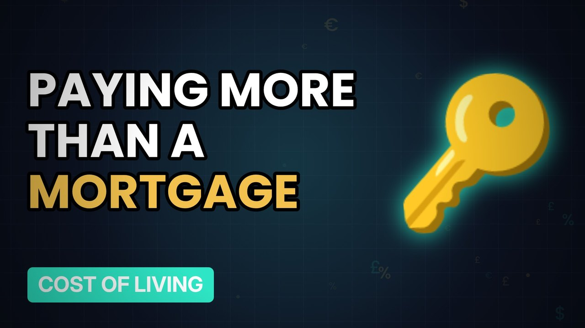

# MV081 · The Rent Trap: Why Renting Can Cost More Than a Mortgage



## Paste this to Claude

```
Make video MV081 from my idea bank: write and fact-check the full 5+ minute script, render it in its style, and send it to me.
```

**Category:** Cost of living  
**Editing style:** Ledger. Dark motion graphics: glowing numbers, charts and icons, soft crossfades. Clean and data-led.  
**Length:** 6 to 8 minutes (about 1,000 to 1,300 words)

## Hook (first line)

> Millions of renters pay more each month than a mortgage would cost, but still can't buy.

## Outline

1. Rent vs mortgage payments
2. The deposit problem
3. Saving while renting
4. Help available
5. Landlord costs explained
6. Ways out

## YouTube title

The Rent Trap: Why Renting Can Cost More Than a Mortgage

## YouTube description

```
Millions of renters pay more each month than a mortgage would cost, but still can't buy.

In this video:
- Rent vs mortgage payments
- The deposit problem
- Saving while renting
- Help available
- Landlord costs explained
- Ways out

Sources are listed here once the script has been fact-checked.
This video is for education and entertainment only and is not financial advice.

#money #costofliving #ukmoney
```

## Tags

cost of living, uk money, personal finance uk, the rent trap, rent, trap, renting, cost, money explained

## Facts to check before scripting

- Average UK rent
- Typical mortgage payment comparison

## Script approach

Script formula: the hook is the first sentence (no intro), then 4 to 6 chapters, each opening with a question the viewer wants answered. Keep sentences short and spoken. Close every chapter with a mini-cliffhanger into the next, and end on a one-line takeaway.
