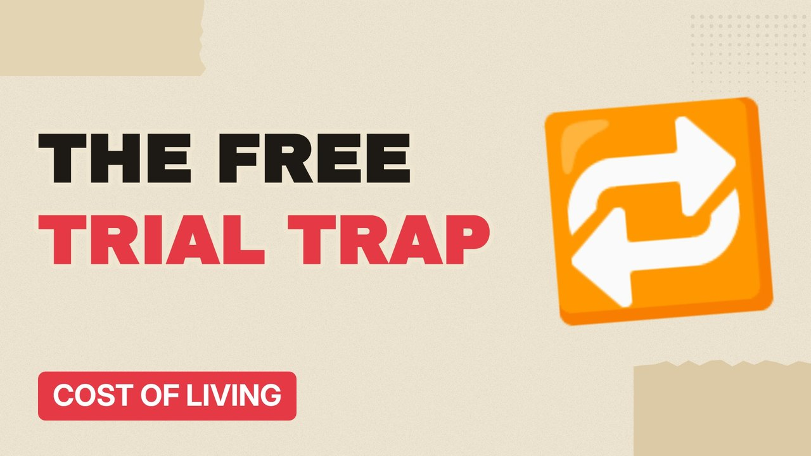

# MV083 · Subscription Traps: How Free Trials Make Billions



## Paste this to Claude

```
Make video MV083 from my idea bank: write and fact-check the full 5+ minute script, render it in its style, and send it to me.
```

**Category:** Cost of living  
**Editing style:** Paper collage. Cream paper, torn cut-outs, red marker colours and heavy type. Each new scene slaps down like a card on a table.  
**Length:** 6 to 8 minutes (about 1,000 to 1,300 words)

## Hook (first line)

> Free trials work because companies know a lot of people will forget to cancel.

## Outline

1. The free trial model
2. Forgotten subscriptions
3. Hard-to-cancel designs
4. New UK rules
5. How much people waste
6. How to audit yours

## YouTube title

Subscription Traps: How Free Trials Make Billions

## YouTube description

```
Free trials work because companies know a lot of people will forget to cancel.

In this video:
- The free trial model
- Forgotten subscriptions
- Hard-to-cancel designs
- New UK rules
- How much people waste
- How to audit yours

Sources are listed here once the script has been fact-checked.
This video is for education and entertainment only and is not financial advice.

#money #costofliving #ukmoney
```

## Tags

cost of living, uk money, personal finance uk, subscription traps, subscription, traps, free, trials, money explained

## Facts to check before scripting

- UK subscription rules in the DMCC Act and timing
- Survey figures on unused subscriptions

## Script approach

Script formula: the hook is the first sentence (no intro), then 4 to 6 chapters, each opening with a question the viewer wants answered. Keep sentences short and spoken. Close every chapter with a mini-cliffhanger into the next, and end on a one-line takeaway.
