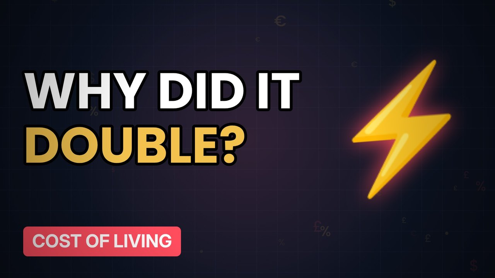

# MV084 · Why Your Energy Bill Doubled



## Paste this to Claude

```
Make video MV084 from my idea bank: write and fact-check the full 5+ minute script, render it in its style, and send it to me.
```

**Category:** Cost of living  
**Editing style:** Ledger. Dark motion graphics: glowing numbers, charts and icons, soft crossfades. Clean and data-led.  
**Length:** 6 to 8 minutes (about 1,000 to 1,300 words)

## Hook (first line)

> In two years UK energy bills went from about £1,200 to over £2,000 a year for a typical home.

## Outline

1. How the price cap works
2. Gas prices and the war in Ukraine
3. Standing charges
4. The government support
5. Where bills are now
6. Cutting your bill

## YouTube title

Why Your Energy Bill Doubled

## YouTube description

```
In two years UK energy bills went from about £1,200 to over £2,000 a year for a typical home.

In this video:
- How the price cap works
- Gas prices and the war in Ukraine
- Standing charges
- The government support
- Where bills are now
- Cutting your bill

Sources are listed here once the script has been fact-checked.
This video is for education and entertainment only and is not financial advice.

#money #costofliving #ukmoney
```

## Tags

cost of living, uk money, personal finance uk, why your energy bill doubled, your, energy, bill, doubled, money explained

## Facts to check before scripting

- Price cap history with dates
- Energy Price Guarantee details

## Script approach

Script formula: the hook is the first sentence (no intro), then 4 to 6 chapters, each opening with a question the viewer wants answered. Keep sentences short and spoken. Close every chapter with a mini-cliffhanger into the next, and end on a one-line takeaway.
