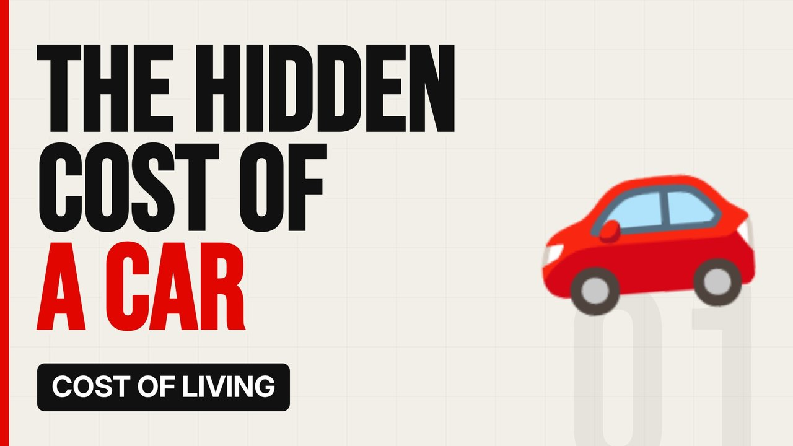

# MV085 · The Real Cost of Running a Car in the UK



## Paste this to Claude

```
Make video MV085 from my idea bank: write and fact-check the full 5+ minute script, render it in its style, and send it to me.
```

**Category:** Cost of living  
**Editing style:** Bold minimal. Off-white page, giant condensed capitals, black and red only. Hard, punchy cuts on the beat.  
**Length:** 6 to 8 minutes (about 1,000 to 1,300 words)

## Hook (first line)

> The price of a car is just the start. Running it can cost thousands more every year.

## Outline

1. Insurance
2. Fuel or charging
3. Tax and MOT
4. Repairs and tyres
5. Depreciation
6. The total yearly cost

## YouTube title

The Real Cost of Running a Car in the UK

## YouTube description

```
The price of a car is just the start. Running it can cost thousands more every year.

In this video:
- Insurance
- Fuel or charging
- Tax and MOT
- Repairs and tyres
- Depreciation
- The total yearly cost

Sources are listed here once the script has been fact-checked.
This video is for education and entertainment only and is not financial advice.

#money #costofliving #ukmoney
```

## Tags

cost of living, uk money, personal finance uk, the real cost of running a car in the uk, real, cost, running, money explained

## Facts to check before scripting

- Average annual running costs from RAC/AA

## Script approach

Script formula: the hook is the first sentence (no intro), then 4 to 6 chapters, each opening with a question the viewer wants answered. Keep sentences short and spoken. Close every chapter with a mini-cliffhanger into the next, and end on a one-line takeaway.
