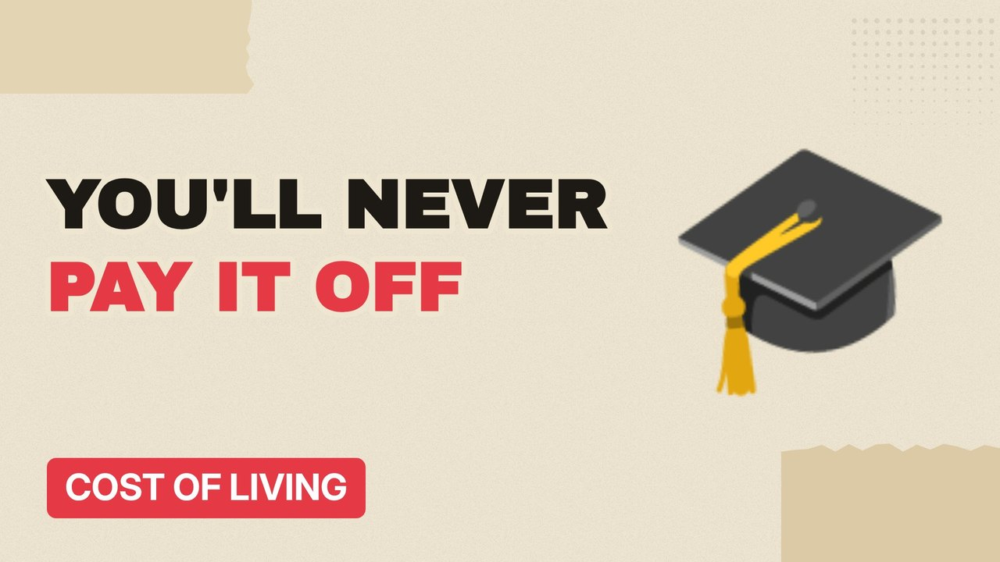

# MV086 · Student Loans Explained: Most People Will Never Pay It Off



## Paste this to Claude

```
Make video MV086 from my idea bank: write and fact-check the full 5+ minute script, render it in its style, and send it to me.
```

**Category:** Cost of living  
**Editing style:** Paper collage. Cream paper, torn cut-outs, red marker colours and heavy type. Each new scene slaps down like a card on a table.  
**Length:** 6 to 8 minutes (about 1,000 to 1,300 words)

## Hook (first line)

> Most English graduates will never pay back their full student loan, and that's by design.

## Outline

1. How the loan works
2. Repayment thresholds
3. Interest
4. Write-off after decades
5. Is it really a tax?
6. What it means for you

## YouTube title

Student Loans Explained: Most People Will Never Pay It Off

## YouTube description

```
Most English graduates will never pay back their full student loan, and that's by design.

In this video:
- How the loan works
- Repayment thresholds
- Interest
- Write-off after decades
- Is it really a tax?
- What it means for you

Sources are listed here once the script has been fact-checked.
This video is for education and entertainment only and is not financial advice.

#money #costofliving #ukmoney
```

## Tags

cost of living, uk money, personal finance uk, student loans explained, student, loans, explained, most, money explained

## Facts to check before scripting

- Plan 5 threshold and write-off term
- Government forecast of share repaid in full

## Script approach

Script formula: the hook is the first sentence (no intro), then 4 to 6 chapters, each opening with a question the viewer wants answered. Keep sentences short and spoken. Close every chapter with a mini-cliffhanger into the next, and end on a one-line takeaway.
