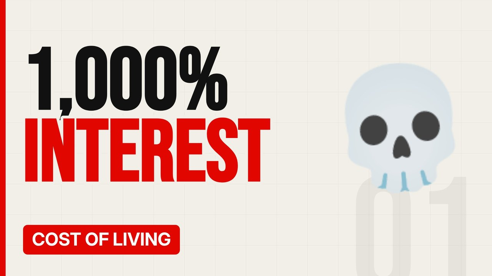

# MV088 · Payday Loans: The 1,000% Interest Trap



## Paste this to Claude

```
Make video MV088 from my idea bank: write and fact-check the full 5+ minute script, render it in its style, and send it to me.
```

**Category:** Cost of living  
**Editing style:** Bold minimal. Off-white page, giant condensed capitals, black and red only. Hard, punchy cuts on the beat.  
**Length:** 6 to 8 minutes (about 1,000 to 1,300 words)

## Hook (first line)

> Before new rules in 2015, some payday loans charged over 1,000% a year in interest.

## Outline

1. How payday loans work
2. APR explained
3. The rollover trap
4. The 2015 price cap
5. Where people turn now
6. Better options

## YouTube title

Payday Loans: The 1,000% Interest Trap

## YouTube description

```
Before new rules in 2015, some payday loans charged over 1,000% a year in interest.

In this video:
- How payday loans work
- APR explained
- The rollover trap
- The 2015 price cap
- Where people turn now
- Better options

Sources are listed here once the script has been fact-checked.
This video is for education and entertainment only and is not financial advice.

#money #costofliving #ukmoney
```

## Tags

cost of living, uk money, personal finance uk, payday loans, payday, loans, interest, trap, money explained

## Facts to check before scripting

- FCA price cap details (0.8% per day, total cost cap)
- Typical APRs before 2015

## Script approach

Script formula: the hook is the first sentence (no intro), then 4 to 6 chapters, each opening with a question the viewer wants answered. Keep sentences short and spoken. Close every chapter with a mini-cliffhanger into the next, and end on a one-line takeaway.
