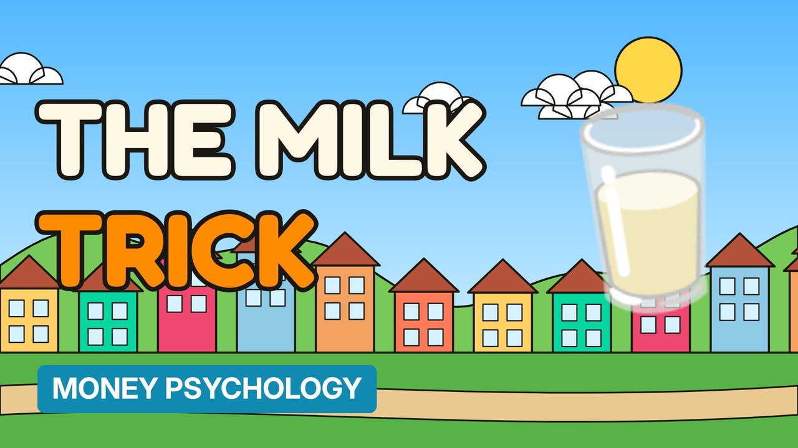

# MV089 · Why Supermarkets Put Milk at the Back



## Paste this to Claude

```
Make video MV089 from my idea bank: write and fact-check the full 5+ minute script, render it in its style, and send it to me.
```

**Category:** Money psychology  
**Editing style:** Cartoon town. Flat 2D cartoon characters in a colourful painted town with ink outlines and speech bubbles. Daylight while the story is set up, then night-blue lighting for the explanation.  
**Length:** 6 to 8 minutes (about 1,000 to 1,300 words)

## Hook (first line)

> The milk is at the back of the shop for a reason, and it isn't the fridges.

## Outline

1. Store layout psychology
2. The long walk past offers
3. Eye-level shelves
4. End-of-aisle deals
5. Smells and music
6. Shop smarter

## YouTube title

Why Supermarkets Put Milk at the Back

## YouTube description

```
The milk is at the back of the shop for a reason, and it isn't the fridges.

In this video:
- Store layout psychology
- The long walk past offers
- Eye-level shelves
- End-of-aisle deals
- Smells and music
- Shop smarter

Sources are listed here once the script has been fact-checked.
This video is for education and entertainment only and is not financial advice.

#money #moneypsychology #consumerpsychology
```

## Tags

money psychology, consumer psychology, spending habits, why supermarkets put milk at the back, supermarkets, milk, back, money explained

## Facts to check before scripting

- Retail research references; note debated claims

## Script approach

Story formula: open on a paradox stated as fact (no intro), set the scene with a named everyday character, escalate in 3 to 5 beats with short dialogue in speech bubbles, then pivot with 'You see,' into the real explanation (lighting turns night-blue) and land on an ironic last line.
