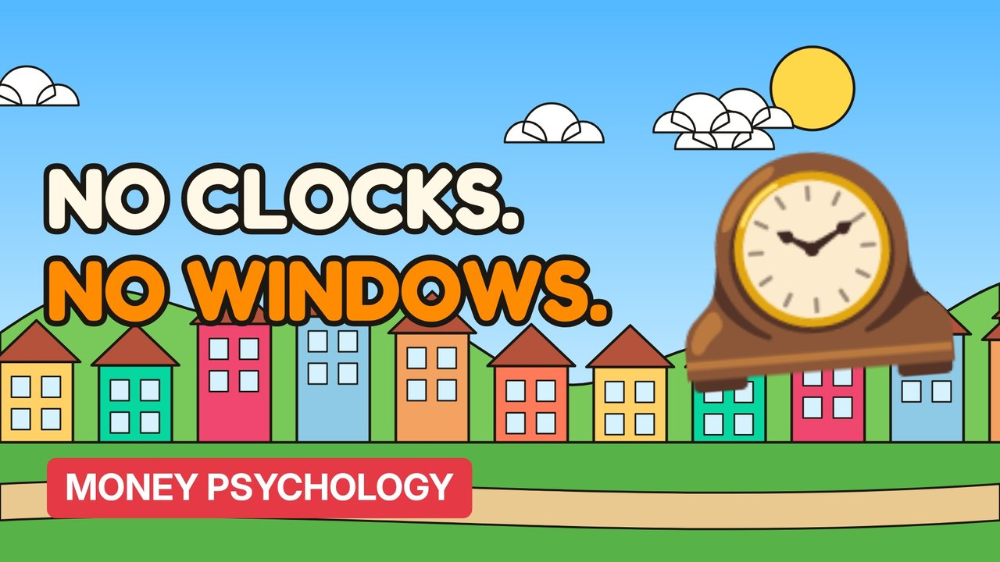

# MV091 · How Casinos Make You Lose Track of Time



## Paste this to Claude

```
Make video MV091 from my idea bank: write and fact-check the full 5+ minute script, render it in its style, and send it to me.
```

**Category:** Money psychology  
**Editing style:** Cartoon town. Flat 2D cartoon characters in a colourful painted town with ink outlines and speech bubbles. Daylight while the story is set up, then night-blue lighting for the explanation.  
**Length:** 6 to 8 minutes (about 1,000 to 1,300 words)

## Hook (first line)

> No clocks, no windows and free drinks. None of that is an accident.

## Outline

1. Casino design
2. Lights and sounds
3. Near misses
4. Losses disguised as wins
5. Comps
6. Protecting yourself

## YouTube title

How Casinos Make You Lose Track of Time

## YouTube description

```
No clocks, no windows and free drinks. None of that is an accident.

In this video:
- Casino design
- Lights and sounds
- Near misses
- Losses disguised as wins
- Comps
- Protecting yourself

Sources are listed here once the script has been fact-checked.
This video is for education and entertainment only and is not financial advice.

#money #moneypsychology #consumerpsychology
```

## Tags

money psychology, consumer psychology, spending habits, how casinos make you lose track of time, casinos, make, lose, track, money explained

## Facts to check before scripting

- Research on near-miss and LDW effects

## Script approach

Story formula: open on a paradox stated as fact (no intro), set the scene with a named everyday character, escalate in 3 to 5 beats with short dialogue in speech bubbles, then pivot with 'You see,' into the real explanation (lighting turns night-blue) and land on an ironic last line.
