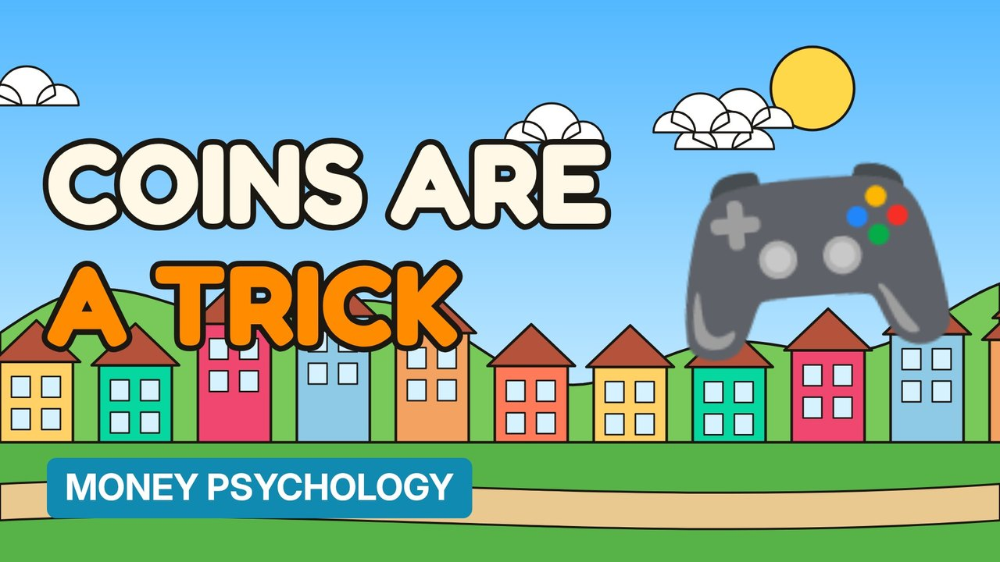

# MV093 · How Games Make You Spend Real Money



## Paste this to Claude

```
Make video MV093 from my idea bank: write and fact-check the full 5+ minute script, render it in its style, and send it to me.
```

**Category:** Money psychology  
**Editing style:** Cartoon town. Flat 2D cartoon characters in a colourful painted town with ink outlines and speech bubbles. Daylight while the story is set up, then night-blue lighting for the explanation.  
**Length:** 6 to 8 minutes (about 1,000 to 1,300 words)

## Hook (first line)

> In-game coins exist so you stop thinking about how much real money you're spending.

## Outline

1. Virtual currencies
2. Odd bundle sizes
3. Loot boxes
4. Limited-time offers
5. Whales and free players
6. Spotting the tricks

## YouTube title

How Games Make You Spend Real Money

## YouTube description

```
In-game coins exist so you stop thinking about how much real money you're spending.

In this video:
- Virtual currencies
- Odd bundle sizes
- Loot boxes
- Limited-time offers
- Whales and free players
- Spotting the tricks

Sources are listed here once the script has been fact-checked.
This video is for education and entertainment only and is not financial advice.

#money #moneypsychology #consumerpsychology
```

## Tags

money psychology, consumer psychology, spending habits, how games make you spend real money, games, make, spend, real, money explained

## Facts to check before scripting

- UK position on loot boxes
- Revenue share from top spenders (research)

## Script approach

Story formula: open on a paradox stated as fact (no intro), set the scene with a named everyday character, escalate in 3 to 5 beats with short dialogue in speech bubbles, then pivot with 'You see,' into the real explanation (lighting turns night-blue) and land on an ironic last line.
