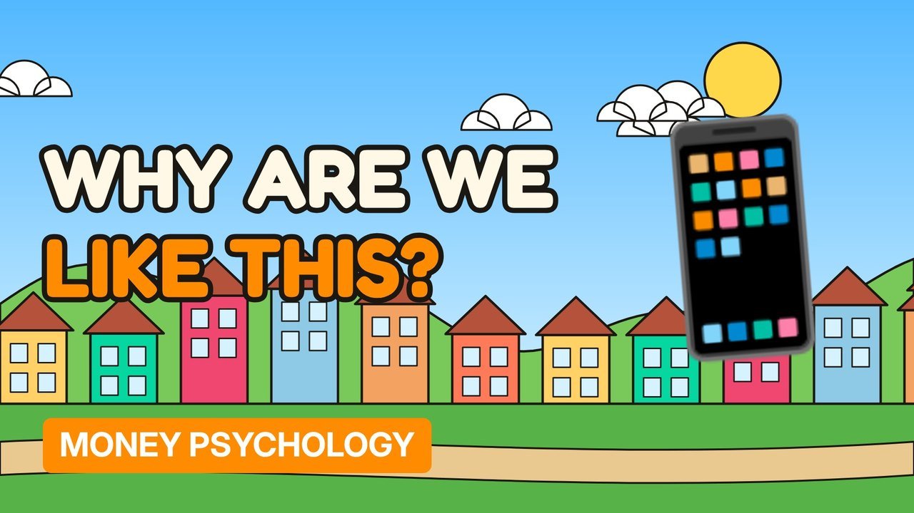

# MV095 · Why We Pay £4 for Coffee but Hate Paying £4 for an App



## Paste this to Claude

```
Make video MV095 from my idea bank: write and fact-check the full 5+ minute script, render it in its style, and send it to me.
```

**Category:** Money psychology  
**Editing style:** Cartoon town. Flat 2D cartoon characters in a colourful painted town with ink outlines and speech bubbles. Daylight while the story is set up, then night-blue lighting for the explanation.  
**Length:** 6 to 8 minutes (about 1,000 to 1,300 words)

## Hook (first line)

> We'll happily buy a coffee gone in ten minutes, but think twice about an app we use every day.

## Outline

1. Mental accounting
2. Anchoring
3. The zero price effect
4. Free apps and adverts
5. Habit vs value
6. Spending on purpose

## YouTube title

Why We Pay £4 for Coffee but Hate Paying £4 for an App

## YouTube description

```
We'll happily buy a coffee gone in ten minutes, but think twice about an app we use every day.

In this video:
- Mental accounting
- Anchoring
- The zero price effect
- Free apps and adverts
- Habit vs value
- Spending on purpose

Sources are listed here once the script has been fact-checked.
This video is for education and entertainment only and is not financial advice.

#money #moneypsychology #consumerpsychology
```

## Tags

money psychology, consumer psychology, spending habits, why we pay £4 for coffee but hate paying £4 for an app, coffee, hate, paying, money explained

## Facts to check before scripting

- Research on the zero price effect

## Script approach

Story formula: open on a paradox stated as fact (no intro), set the scene with a named everyday character, escalate in 3 to 5 beats with short dialogue in speech bubbles, then pivot with 'You see,' into the real explanation (lighting turns night-blue) and land on an ironic last line.
