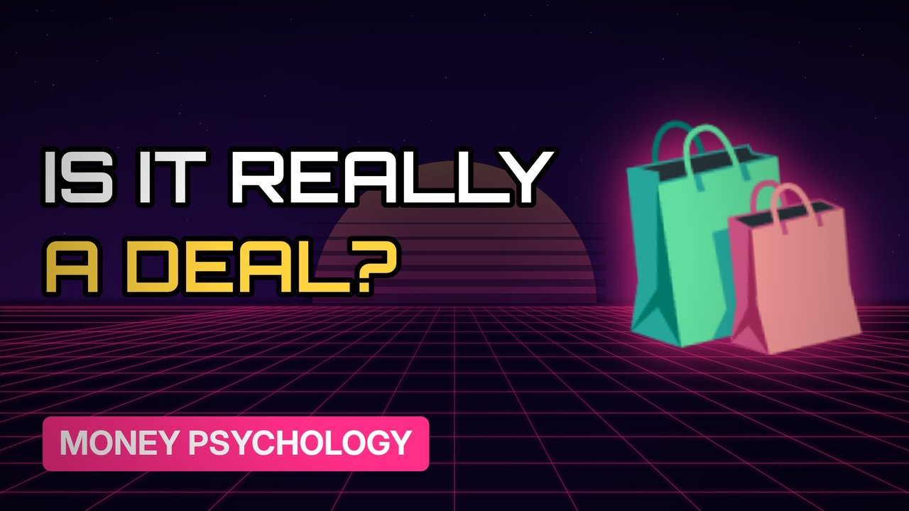

# MV096 · How Black Friday Deals Trick You



## Paste this to Claude

```
Make video MV096 from my idea bank: write and fact-check the full 5+ minute script, render it in its style, and send it to me.
```

**Category:** Money psychology  
**Editing style:** Synthwave neon. Purple night sky, glowing grid floor and neon type. Scenes change with a quick glitch.  
**Length:** 6 to 8 minutes (about 1,000 to 1,300 words)

## Hook (first line)

> Some Black Friday deals are the same price, or more, than earlier in the year.

## Outline

1. Where Black Friday came from
2. Fake was-prices
3. Countdown timers
4. What Which? found
5. Real bargains
6. How to check a deal

## YouTube title

How Black Friday Deals Trick You

## YouTube description

```
Some Black Friday deals are the same price, or more, than earlier in the year.

In this video:
- Where Black Friday came from
- Fake was-prices
- Countdown timers
- What Which? found
- Real bargains
- How to check a deal

Sources are listed here once the script has been fact-checked.
This video is for education and entertainment only and is not financial advice.

#money #moneypsychology #consumerpsychology
```

## Tags

money psychology, consumer psychology, spending habits, how black friday deals trick you, black, friday, deals, trick, money explained

## Facts to check before scripting

- Which? Black Friday price-tracking findings

## Script approach

Script formula: the hook is the first sentence (no intro), then 4 to 6 chapters, each opening with a question the viewer wants answered. Keep sentences short and spoken. Close every chapter with a mini-cliffhanger into the next, and end on a one-line takeaway.
