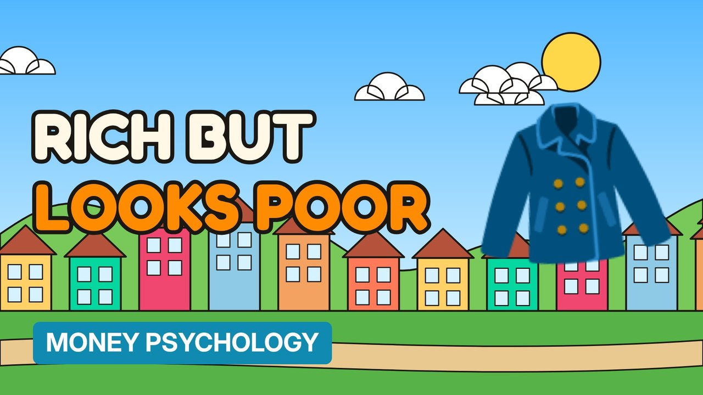

# MV097 · Why Rich People Look Poor



## Paste this to Claude

```
Make video MV097 from my idea bank: write and fact-check the full 5+ minute script, render it in its style, and send it to me.
```

**Category:** Money psychology  
**Editing style:** Cartoon town. Flat 2D cartoon characters in a colourful painted town with ink outlines and speech bubbles. Daylight while the story is set up, then night-blue lighting for the explanation.  
**Length:** 6 to 8 minutes (about 1,000 to 1,300 words)

## Hook (first line)

> Plenty of wealthy people drive old cars and wear plain clothes, on purpose.

## Outline

1. Stealth wealth
2. Spending vs building
3. Status signals
4. The cost of looking rich
5. Quiet luxury
6. What to copy

## YouTube title

Why Rich People Look Poor

## YouTube description

```
Plenty of wealthy people drive old cars and wear plain clothes, on purpose.

In this video:
- Stealth wealth
- Spending vs building
- Status signals
- The cost of looking rich
- Quiet luxury
- What to copy

Sources are listed here once the script has been fact-checked.
This video is for education and entertainment only and is not financial advice.

#money #moneypsychology #consumerpsychology
```

## Tags

money psychology, consumer psychology, spending habits, why rich people look poor, rich, people, look, poor, money explained

## Facts to check before scripting

- The Millionaire Next Door findings

## Script approach

Story formula: open on a paradox stated as fact (no intro), set the scene with a named everyday character, escalate in 3 to 5 beats with short dialogue in speech bubbles, then pivot with 'You see,' into the real explanation (lighting turns night-blue) and land on an ironic last line.
