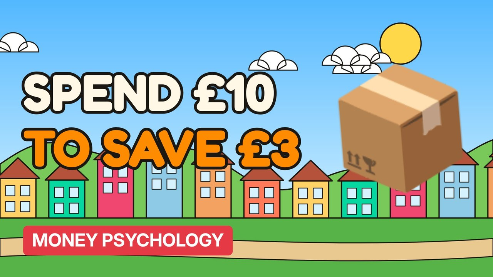

# MV099 · Why Free Delivery Makes You Spend More



## Paste this to Claude

```
Make video MV099 from my idea bank: write and fact-check the full 5+ minute script, render it in its style, and send it to me.
```

**Category:** Money psychology  
**Editing style:** Cartoon town. Flat 2D cartoon characters in a colourful painted town with ink outlines and speech bubbles. Daylight while the story is set up, then night-blue lighting for the explanation.  
**Length:** 6 to 8 minutes (about 1,000 to 1,300 words)

## Hook (first line)

> People will add £10 to their basket to avoid a £3 delivery fee.

## Outline

1. Free delivery thresholds
2. Loss aversion
3. Subscription delivery
4. Returns costs
5. Who really pays
6. Beating the threshold trap

## YouTube title

Why Free Delivery Makes You Spend More

## YouTube description

```
People will add £10 to their basket to avoid a £3 delivery fee.

In this video:
- Free delivery thresholds
- Loss aversion
- Subscription delivery
- Returns costs
- Who really pays
- Beating the threshold trap

Sources are listed here once the script has been fact-checked.
This video is for education and entertainment only and is not financial advice.

#money #moneypsychology #consumerpsychology
```

## Tags

money psychology, consumer psychology, spending habits, why free delivery makes you spend more, free, delivery, makes, spend, money explained

## Facts to check before scripting

- Studies/surveys on free delivery behaviour

## Script approach

Story formula: open on a paradox stated as fact (no intro), set the scene with a named everyday character, escalate in 3 to 5 beats with short dialogue in speech bubbles, then pivot with 'You see,' into the real explanation (lighting turns night-blue) and land on an ironic last line.
