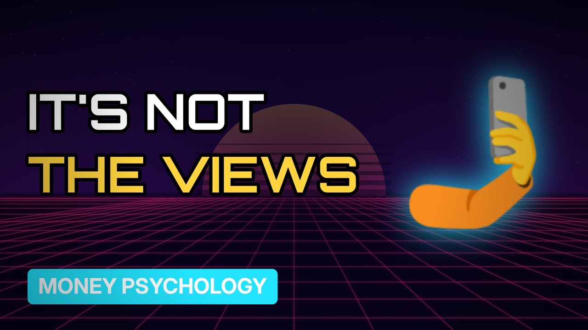

# MV100 · How Influencers Really Make Money



## Paste this to Claude

```
Make video MV100 from my idea bank: write and fact-check the full 5+ minute script, render it in its style, and send it to me.
```

**Category:** Money psychology  
**Editing style:** Synthwave neon. Purple night sky, glowing grid floor and neon type. Scenes change with a quick glitch.  
**Length:** 6 to 8 minutes (about 1,000 to 1,300 words)

## Hook (first line)

> An influencer's biggest income often isn't from views at all.

## Outline

1. Ad revenue vs sponsorships
2. Affiliate links
3. Selling courses and products
4. Fake followers
5. UK ad disclosure rules
6. What it really pays

## YouTube title

How Influencers Really Make Money

## YouTube description

```
An influencer's biggest income often isn't from views at all.

In this video:
- Ad revenue vs sponsorships
- Affiliate links
- Selling courses and products
- Fake followers
- UK ad disclosure rules
- What it really pays

Sources are listed here once the script has been fact-checked.
This video is for education and entertainment only and is not financial advice.

#money #moneypsychology #consumerpsychology
```

## Tags

money psychology, consumer psychology, spending habits, how influencers really make money, influencers, really, make, money, money explained

## Facts to check before scripting

- ASA/CMA disclosure rules
- Typical sponsorship rates (sources)

## Script approach

Script formula: the hook is the first sentence (no intro), then 4 to 6 chapters, each opening with a question the viewer wants answered. Keep sentences short and spoken. Close every chapter with a mini-cliffhanger into the next, and end on a one-line takeaway.
